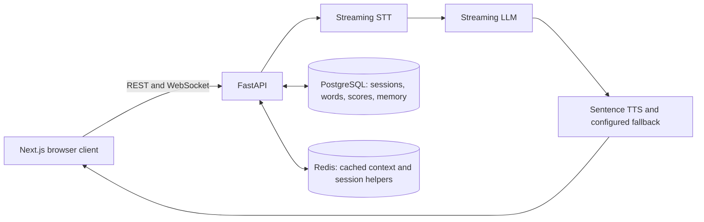
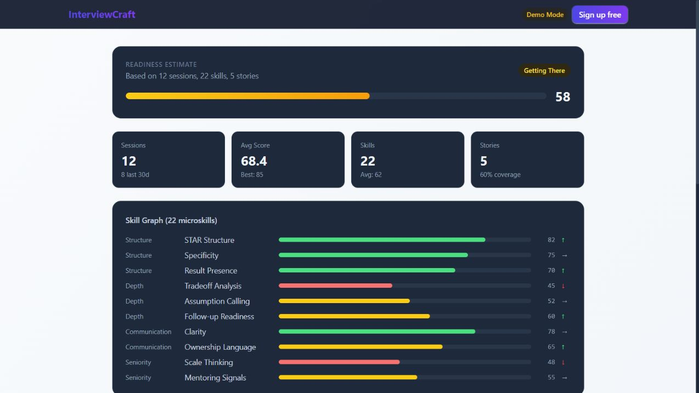

# Voice AI Interview Coach

**Interviewcraft — an independent engineering project by Alexander Doroshevich.**

Built an independent voice-AI interview practice application with a Python/FastAPI backend and Next.js frontend. Implemented streaming conversation orchestration, interruption handling, TTS fallback, cross-session memory, and feedback linked to transcript timestamps. Created for practical learning and implementation of AI systems.

## Engineering implementation

- **Streaming conversation:** browser audio over WebSocket → Deepgram STT → streamed LLM text → sentence-level TTS and audio playback. The asyncio orchestrator handles interruptions and cancels obsolete generation and synthesis tasks.
- **Explicit TTS fallback:** ElevenLabs synthesis can fall back to Deepgram. STT, budget TTS and fallback use the same session-resolved Deepgram credential; a failing user key does not silently switch costs to the platform owner.
- **Cross-session memory:** PostgreSQL stores sessions and coaching memory. Redis caches formatted context for loading into a later voice session; scoring triggers the background memory builder.
- **Inspectable feedback:** scoring selects transcript time spans, and the server extracts quote text from stored words so feedback can be inspected against the cited passage.
- **Provider interfaces and usage:** STT/LLM/TTS interfaces, session quality profiles and token/cost estimates make the voice pipeline's provider choices and usage explicit.

## Architecture



The voice runtime uses custom asyncio orchestration in [pipeline.py](backend/app/services/voice/pipeline.py). See the [interfaces](backend/app/services/voice/interfaces.py), [provider factory](backend/app/services/voice/provider_factory.py), [scorer](backend/app/services/scoring/scorer.py), [memory loader](backend/app/services/memory/loader.py) and [builder](backend/app/services/memory/builder.py).

Design decisions: [WebSocket](docs/adr/001-websocket-vs-webrtc.md), [stack](docs/adr/002-tech-stack.md), [scoring](docs/adr/003-scoring-architecture.md), [provider boundaries](docs/adr/005-provider-abstractions.md) and [scoring stability](docs/adr/008-scoring-stability.md).

## Run locally

Use Python **3.13+**, Node.js **20+**, PostgreSQL and Redis. From the repository root:

```sh
python -m venv .venv
# Activate: Windows .venv\Scripts\Activate.ps1; POSIX source .venv/bin/activate
python -m pip install -e "./backend[dev]"
docker compose up -d postgres redis
```

Copy `.env.example` to `.env` locally and configure the provider credentials and a development secret. For a backend running on the host, use PostgreSQL/Redis addresses matching docker-compose (defaults localhost:5432/interviewcraft and localhost:6379). Keep secrets out of Git. Google/SMTP integrations are optional for local voice practice.

```sh
cd backend
python -m alembic upgrade head
python -m uvicorn app.main:app --host 127.0.0.1 --port 8080
```

In another terminal, set the frontend's `NEXT_PUBLIC_API_URL=http://localhost:8080`:

```sh
cd frontend
npm ci --legacy-peer-deps
npm run dev
```

Open http://localhost:3000. Voice practice uses the configured external APIs and incurs their usage charges. The `/demo` route can be viewed without an AI backend.

### Screenshots: static UI with synthetic data

These are captures of the actual local frontend. Session counts, scores, readiness and costs on `/demo` are **hardcoded synthetic sample data, not results of a live AI session**.



[Mobile viewport: static synthetic demo](docs/screenshots/local-demo-mobile.jpg) · [Login screen](docs/screenshots/local-login.jpg)

## Tests

```sh
cd backend
python -m pytest -m "not integration and not nightly" -q
python -m ruff check .
python -m mypy app/

# From repository root in a separate terminal:
cd frontend
npm run lint
npm run type-check
npm test
npm run build
```

[Targeted regressions](backend/tests/test_portfolio_regressions.py) cover cache-token costs, credential ownership, fallback, schema references, cancellation and memory decoding. See also [provider mocks](backend/tests/test_voice_providers.py), [memory tests](backend/tests/services/memory/) and [scoring tests](backend/tests/scoring/test_golden_answers.py).

[Backend CI](.github/workflows/backend-ci.yml) runs Ruff, Mypy and tests excluding integration; the [PR gate](.github/workflows/pr-gate.yml) also excludes nightly tests. [Frontend CI](.github/workflows/frontend-ci.yml) runs lint, types, unit tests, build and a landing-page E2E check. Real-provider evaluation is separate: [methodology and markers](docs/evals.md), [benchmark entry points](benchmarks/README.md). Committed `results/example.json` files are synthetic output examples.

## Limitations

Scoring and parts of memory call Anthropic directly, so provider interchangeability is partial. Transcript quote extraction makes citations inspectable, but does not establish correct interpretation or objective scoring; caching does not guarantee identical answers. Usage costs are estimates rather than invoices, and failed/repair attempts need reconciliation for billing-grade accounting. Current public demo availability and a complete live voice → scoring → next-session memory run remain unverified. This is an independent engineering project; no measured adoption or business impact is claimed.

## License

[MIT](LICENSE).
